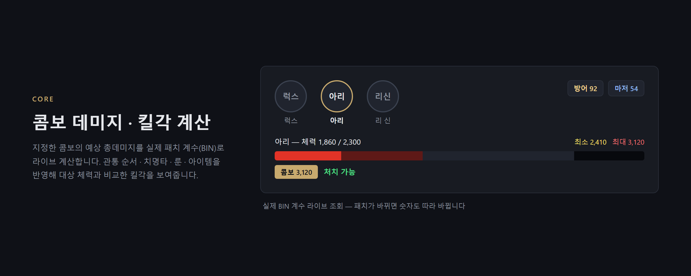
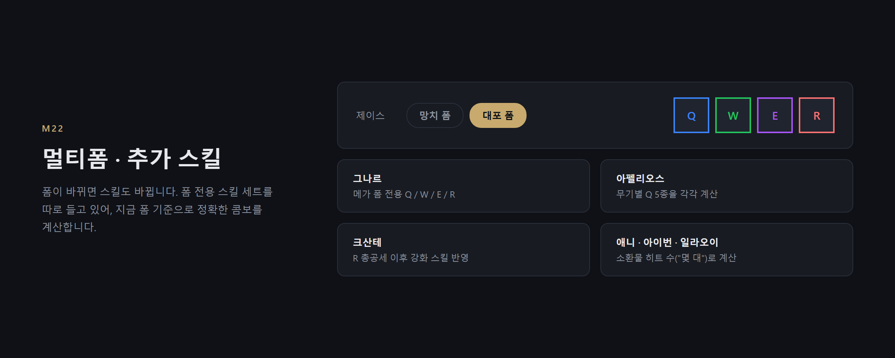
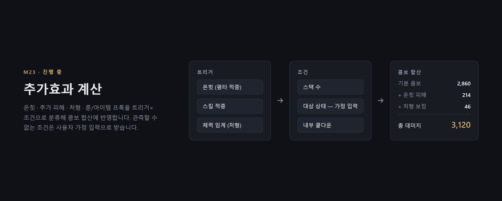
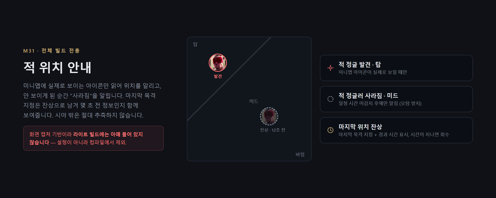
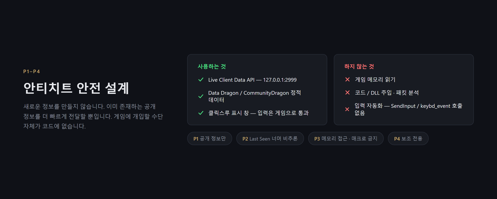
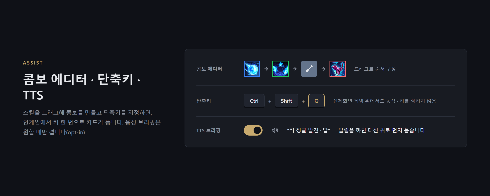

# Fova

**A lightweight League of Legends desktop companion — combo damage calculator with an in-game
overlay, plus champ-select rune & spell presets.**

가볍고 정직한 리그 오브 레전드 데스크톱 컴패니언 — 콤보 데미지 계산기 + 인게임 오버레이,
그리고 픽창 룬/스펠 프리셋.

> Status: pre-release (open beta). **The source is here** — this repository holds both the product page and the code that produces the published build.
> 배포 브랜치(`main`)만 공개합니다. 개발 기록과 작업 히스토리는 비공개로 둡니다.

---

## 설치하기 · Install

### 요구 사항 · Requirements

- Windows 10 (2004 이상) / 11, 64비트
- .NET 8 **Desktop** Runtime (x64) — 인스톨러 사용 시 자동 설치
- League of Legends (KR/global clients)

### 인스톨러로 설치 (권장)

**[⬇ Fova 설치 파일 내려받기](https://github.com/JiMin7788/lol_overlay_fova/releases/latest/download/FovaApp-win-Setup.exe)** (약 13 MB, 항상 최신 버전)

일반적인 설치 프로그램입니다. 실행하면 알아서 처리합니다:

- **.NET 8 데스크톱 런타임** — 없으면 설치 중에 Microsoft 공식 설치기를 내려받아 설치합니다.
  이미 있으면 건너뜁니다.
- 사용자 폴더(`%LocalAppData%\FovaApp`)에 설치 — **관리자 권한 불필요**. 설정은
  `%LocalAppData%\Fova`에 따로 보관돼 업데이트·재설치해도 유지됩니다.
- **바탕화면·시작 메뉴 바로가기** 생성, Windows "앱 제거" 지원.
- **자동 업데이트** — 실행할 때 새 버전을 확인해 바뀐 부분만 백그라운드로 받아 두고, Fova를
  닫을 때 적용합니다. 게임 중에 재시작되는 일은 없습니다.
- 0.3.3 이하를 예전 설치 파일로 설치했다면, 새 버전이 처음 실행될 때 설정을 옮기고 예전 설치를
  자동으로 지웁니다.
- 챔피언·스킬 아이콘과 패치 데이터(Data Dragon)는 기본 데이터가 동봉돼 있고, 첫 온라인 실행 때
  최신으로 자동 갱신됩니다 — 따로 할 일이 없습니다.

### "Windows의 PC 보호" 파란 경고가 떠요

정상입니다. Fova는 아직 **코드 서명 인증서로 서명되지 않아** Windows SmartScreen이
"인식할 수 없는 앱"으로 표시합니다 — 다운로드 이력이 적은 모든 무서명 프로그램에 뜨는
경고이고, 악성 판정이 아닙니다. **"추가 정보" → "실행"**을 누르면 설치가 진행됩니다.
파일은 [GitHub Releases](https://github.com/JiMin7788/lol_overlay_fova/releases)에서만 배포하며,
각 파일의 SHA-256이 릴리스 페이지에 표시됩니다.

### 압축(zip)으로 설치 — 포터블

**[⬇ Fova 포터블 zip 내려받기](https://github.com/JiMin7788/lol_overlay_fova/releases/latest/download/FovaApp-win-Portable.zip)** — 원하는 폴더에 풀고
`Fova.exe` 실행. 자동 업데이트도 똑같이 됩니다. 지울 때는 폴더만 삭제하면 됩니다. 단,
**.NET 8 Desktop Runtime은 직접 설치**해야 합니다
([다운로드](https://dotnet.microsoft.com/ko-kr/download/dotnet/8.0/runtime) — 반드시
"Desktop Runtime"을 고르세요. 그냥 "Runtime"으로는 안 켜집니다).

### 관리자 권한에 대해 — 정정 (2026-08-21)

이 문단에는 원래 "롤이 관리자 권한으로 돌아가서 Fova도 권한을 올려야 인게임 단축키가 먹는다"고
적혀 있었습니다. **실측 결과 사실이 아닙니다** — 롤 클라이언트는 기본적으로 medium integrity로
돌고, 키보드 훅에는 관리자 권한이 필요 없습니다. 그래서 Fova는 이제 권한을 올리지 않습니다.

> 롤을 직접 관리자 권한으로 실행하는 특수한 경우에만, Fova도 우클릭 → "관리자 권한으로 실행"으로
> 맞춰 주세요. 권한이 다르면 게임 안에서 단축키가 안 먹습니다. 기본 설치라면 해당 없습니다.

---

## What it does · 무엇을 하나요

### 콤보 데미지 계산기 · Combo damage calculator



**Combo damage calculator (콤보 데미지 계산기)** — build ability combos per champion; during a
match, a click-through overlay shows the combo's expected damage against your current target,
computed from your own live stats (levels, items, runes). Damage formulas come from Riot's own
static game data, hand-verified per champion.



폼이 바뀌면 스킬 세트도 바뀝니다 — 제이스 대포/망치, 그나르 메가, 아펠리오스 무기별 Q, 크산테 R
총공세, 소환수 히트 수까지 지금 폼 기준으로 계산합니다.



온힛·처형·룬/아이템 프록 같은 추가효과는 트리거×조건으로 분류해 합산에 반영합니다(개발 중). 관측할
수 없는 조건은 추측하지 않고 사용자 가정 입력으로 받습니다.

### 픽창 보조 · Champ-select assistant

**Champ-select assistant (픽창 보조)** — save your preferred rune page and summoner spells per
champion, then re-apply them with one click (or an explicit opt-in auto-apply on lock-in) through
the League Client's own local API. Your hand-made rune pages are never touched without an
explicit confirmation.

### 편의 기능 · Quality-of-life helpers

**Quality-of-life helpers** — objective respawn timers, optional voice (TTS) alerts.

억제기·넥서스 포탑 리스폰 타이머를 실제 인게임 API 이벤트로 추적합니다.

> **잠시 꺼 둔 기능 (0.3.3~)** — 귀환 타이머, 라인 복귀 예측, 적 정글러 발견 알림, 적 아이템 완성 알림은
> Riot에 허용 여부를 문의하는 동안 꺼 두었습니다. 답을 받으면 앱 업데이트 없이 다시 켜집니다.
> *Paused while we ask Riot whether they are allowed: recall timer, lane-return prediction,
> enemy-jungler spotted and enemy item completion alerts. They come back without an app update if approved.*

### 적 위치 안내 · Enemy position tracking (전체 기능 빌드 전용)



미니맵에 실제로 보이는 아이콘만 읽어 위치를 알리고, 안 보이게 되면 "사라짐"을 알립니다. 마지막 목격
지점은 잔상 + 경과 시간으로 남습니다. **공개 배포본(라이트 빌드)에는 화면을 읽는 코드가 없어 이
기능이 들어 있지 않습니다** — 소스에서 전체 빌드 시에만 사용할 수 있습니다.

## Safety & fair play · 안전과 공정성



Fova is designed to be anti-cheat-safe and policy-compliant by construction:

- Reads **only public, Riot-provided data**: the local Live Client Data API
  (`https://127.0.0.1:2999`), Data Dragon, CommunityDragon static data, and the local League
  Client (LCU) API for champ-select rune/spell writes.
- **No memory reading, no injection, no input automation, no scripting, no packet manipulation.**
- The overlay is a separate click-through window that **displays information only** — it never
  acts in-game on your behalf, and it infers nothing beyond what the game client publishes
  (no fog-of-war prediction).
- **No ads in-game, ever.** In line with Riot's third-party advertising policy (effective
  2025-05-29), advertising exists only as a single static banner in the desktop app's home
  window, and the ad slot hard-disables the moment a game is detected. Fova is free for all
  players.
- **Anonymous usage stats and crash reports only** (an install id minted on your PC, app and
  Windows version, scrubbed error text) — no account or game data; switch it off in Settings.
  익명 사용 통계·오류 리포트만 보내며 끌 수 있습니다: [개인정보 안내](https://jimin7788.github.io/lol_overlay_fova/privacy.html)

## 쓰는 법 · Usage

게임에 들어가면 오버레이가 자동으로 켜집니다.

| 기본 단축키 | 기능 |
| --- | --- |
| `Shift + Tab` | 오버레이 켜고 끄기 |
| `Alt + 1` | 콤보 결과 오버레이 |
| `Alt + 2` | 스킬별 데미지 오버레이 |



**콤보 만들기**: 홈 창 → 콤보 설정 → 챔피언 선택 → 스킬을 순서대로 끌어다 놓기 → 단축키 지정.
**위치 보정**: 설정에서 "이동 여부"를 켠 뒤 `Ctrl+Shift`를 누른 채 카드를 드래그.
키를 누르지 않은 동안에는 클릭이 게임으로 그대로 통과합니다.

### 잘 안 될 때

- **앱이 아예 안 켜져요** → .NET 8 **Desktop** Runtime을 확인하세요 (인스톨러로 설치했다면
  자동으로 깔려 있고, zip 설치라면 직접 설치해야 합니다 — 위 설치 섹션 참고).
- **게임 안에서만 단축키가 안 먹어요** → 롤을 관리자 권한으로 실행 중인지 확인하세요. 그렇다면
  Fova도 관리자 권한으로 실행해 권한을 맞춰야 합니다 (기본 설치에서는 발생하지 않습니다).
- **숫자가 안 나와요** → 연습 모드나 실제 게임에 들어가야 인게임 API가 열립니다.
- **백신이 경고해요** → 아래 "키보드 훅" 항목을 봐주세요.

---

## 키보드 훅에 대해 · About the keyboard hook

게임 위에서 단축키를 받으려면 이 방법뿐이라 **전역 키보드 훅**을 씁니다. 백신이 민감하게 보는
API라 경고가 뜰 수 있어서, 하는 일과 안 하는 일을 적어둡니다. 코드는
[`src/Overlay.Client/Hotkeys/LowLevelHotkeyHook.cs`](src/Overlay.Client/Hotkeys/LowLevelHotkeyHook.cs)
에서 직접 확인하실 수 있습니다.

- **키를 가로채지 않습니다.** `HookCallback`의 반환 경로는 `return CallNextHookEx(...)` 하나뿐이라
  모든 입력이 그대로 게임에 전달됩니다.
- **키를 저장하거나 전송하지 않습니다.** 기억하는 건 등록된 단축키 조합과 지금 눌린
  `Ctrl`/`Alt`/`Shift`뿐입니다. 입력 기록도, 파일 저장도, 네트워크 전송도 없습니다.
- `GetAsyncKeyState` / `GetKeyboardState`를 쓰지 않고, `SendInput` / `keybd_event`도 없습니다 —
  **대신 키를 눌러줄 수단이 코드에 없습니다.**

훅을 쓰지 않는 구현(`Hotkeys/Win32HotkeyHook.cs`)도 트리에 있지만, 인게임 단축키와 클릭-투-타겟을
잃습니다.

---

## 빌드 · Building

```
dotnet build LolOverlay.sln -c Release -p:LightMode=true
pwsh packaging/build-release.ps1 -Version 1.0.0
```

`LightMode`는 **미니맵 화면 캡처 기능을 컴파일 단계에서 제외**합니다. 공개 배포본에는 화면을 읽는
코드가 들어 있지 않습니다 (Vortice/DXGI/WGC 의존성 0개).

## Contact · 문의

Open an issue on this repository.

---

## 라이선스 · License

**소스는 공개돼 있지만 오픈소스가 아닙니다.** 공개는 검증을 위한 것이지 재사용 허가가 아닙니다.

- ✅ **개인적·비상업적 사용**, 소스 열람과 **안전성 검증**, 개인 용도 수정
- ❌ 재배포·공개 게시(수정 여부 무관), 판매·상업적 이용, **동봉 데이터 추출 후 별도 사용**

전문은 [LICENSE](LICENSE)를 봐주세요. 그 범위를 넘는 이용은 문의 바랍니다.

---

<sub>Fova는 Riot Games가 승인하거나 후원한 프로그램이 아닙니다. 서드파티 도구에 대한 정책은 Riot이 언제든 변경할 수 있으며 그 부분은 저희가 통제할 수 없습니다.<br>
Fova isn't endorsed by Riot Games and doesn't reflect the views or opinions of Riot Games or anyone officially involved in producing or managing Riot Games properties. Riot Games, and all associated properties are trademarks or registered trademarks of Riot Games, Inc.<br>
Fova는 Riot Games의 보증을 받지 않았으며, Riot Games 또는 Riot Games 자산의 제작·관리에 공식적으로 관여하는 누구의 견해나 의견도 대변하지 않습니다. Riot Games 및 모든 관련 자산은 Riot Games, Inc.의 상표 또는 등록 상표입니다.</sub>
